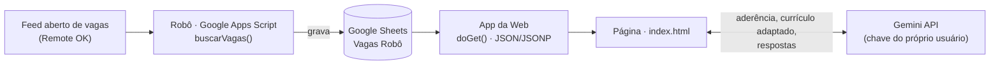

# Assistente de Vagas

Robô que busca vagas de tecnologia sozinho e uma página que, para cada vaga, calcula a **aderência ao seu currículo**, mostra **o que você já tem e o que falta** e gera um **currículo adaptado** (em texto e PDF) com IA, tudo com ferramentas gratuitas.

## Como funciona

| Parte | Arquivo | O que faz |
|---|---|---|
| Robô | [apps-script/Codigo.gs](apps-script/Codigo.gs) | Busca vagas por termos (dev, javascript, frontend, ai, python, automation), remove duplicadas e grava na planilha. Pode rodar todo dia com um acionador. |
| API | [apps-script/Codigo.gs](apps-script/Codigo.gs) (`doGet`) | Publica as vagas como JSON, com suporte a JSONP para a página funcionar até como arquivo local. |
| Página | [web/index.html](web/index.html) | Lista as vagas, lê o currículo em PDF, calcula a aderência, adapta o currículo, gera o PDF e ajuda a responder perguntas de processos seletivos (por texto ou print). |

## Funcionalidades

- **Vagas do robô**: lista atualizada com um clique, sem gastar IA. A análise só roda quando você abre uma vaga, para poupar o limite grátis.
- **Aderência**: anel de 0 a 100%, com a lista do que você já atende e do que falta reforçar.
- **Currículo adaptado**: destaca o que combina com a vaga, sem inventar experiência, e exporta em PDF.
- **Texto de apresentação**: 3 a 4 linhas em 1ª pessoa para "por que você?".
- **Me ajuda a responder**: cole a pergunta ou suba o print, e a IA sugere uma resposta baseada no seu currículo.
- **Escolha automática de modelo**: tenta os modelos Gemini Flash disponíveis e trata limite diário, chave inválida e tempo esgotado.

## Privacidade

- A chave do Gemini e o currículo ficam **só no navegador** (localStorage). Nada vai para servidor próprio.
- Nenhuma chave fica no código. A URL do robô é configurada por quem instala.

## Como montar

Passo a passo completo em [docs/COMO-MONTAR.md](docs/COMO-MONTAR.md). Resumo:

1. Crie a planilha "Vagas Robô" no Google Sheets.
2. Cole [apps-script/Codigo.gs](apps-script/Codigo.gs) em Extensões → Apps Script e preencha `PLANILHA_ID`.
3. Rode `buscarVagas` e publique como App da Web (acesso: qualquer pessoa).
4. Em [web/index.html](web/index.html), troque `ROBO_URL` pela URL `/exec`.
5. Abra a página, cole sua chave grátis do Gemini ([aistudio.google.com/apikey](https://aistudio.google.com/apikey)) e anexe o currículo.

## Tecnologias

Google Apps Script · Google Sheets · Gemini API · HTML/CSS/JavaScript puro · [pdf.js](https://mozilla.github.io/pdf.js/) · [jsPDF](https://github.com/parallax/jsPDF)

## Limitações

- As vagas vêm do Remote OK: muitas são remotas e em inglês.
- LinkedIn e Gupy bloqueiam robôs, então vagas desses sites não entram na busca automática.
- O plano grátis do Gemini tem limite diário.

## Próximos passos

- Aviso diário por e-mail com as vagas novas
- Painel de entrevistas e candidaturas
- Mais fontes de vagas com foco no Brasil

## Licença

MIT. Veja [LICENSE](LICENSE).
