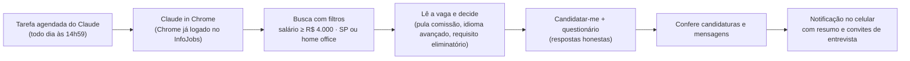

# Candidaturas automáticas no InfoJobs

Agente de IA (Claude) que, todo dia, busca vagas no InfoJobs, filtra pelo perfil e se candidata sozinho a até **10 vagas**, respondendo os questionários com dados reais do currículo. No fim, confere o status das candidaturas e as mensagens das empresas e manda um resumo para o celular.

## Como funciona

| Parte | Arquivo | O que faz |
|---|---|---|
| Instruções do agente | [PROMPT.md](PROMPT.md) | Texto da tarefa agendada: áreas, filtros, regras de honestidade, passo a passo da candidatura e resumo final. |

## Regras principais

- **Até 10 candidaturas por dia**, qualidade acima de quantidade.
- **Áreas:** CRM, Customer Success, Relacionamento, Comercial/SDR, IA/Automação, Suporte de TI, Processos, Front-end Júnior.
- **Filtros:** salário a partir de R$ 4.000, home office ou região, preferência CLT.
- **Pula:** vagas só de comissão, idioma avançado eliminatório, requisito que a pessoa não tem e vagas já candidatadas.
- **Nunca inventa** experiência, diploma ou idioma.
- **Nunca digita senha.** Se aparecer login, captcha ou código, para e avisa.

## Como montar

1. Instale o app **Claude desktop** e a extensão **Claude in Chrome**, e faça login no InfoJobs pelo Chrome.
2. Copie o [PROMPT.md](PROMPT.md) e preencha os campos entre colchetes com o seu perfil real.
3. No Claude, crie uma **tarefa agendada** diária com esse texto, presa ao seu computador e com notificação no celular.
4. No horário da tarefa, deixe o PC ligado, com o Chrome e o app Claude abertos.

## Limitações

- Depende do PC ligado e do Chrome aberto no horário agendado.
- O login pelo navegador interno do app Claude falha no InfoJobs, por isso a automação usa o Chrome.
- Mudanças no layout do InfoJobs podem exigir ajustes no passo a passo.

## Privacidade

Os dados pessoais (telefone, e-mail, histórico) **não ficam no repositório**: o [PROMPT.md](PROMPT.md) usa campos entre colchetes, preenchidos só na tarefa agendada de quem usa.
